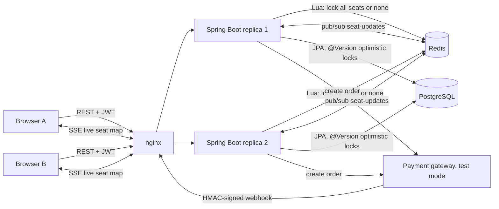

# SeatRush: High-Concurrency Ticket Booking

**A full-stack seat-booking platform built for the "10,000 fans hit Book at 10:00:00" moment. Three independent layers make double booking impossible, even across multiple app instances.**


[](https://github.com/Alkarim786/ticket-booking-platform/actions/workflows/ci.yml)
[](LICENSE)

---

## The problem
When a popular show opens for booking, thousands of people click the same seats in the same second.
- A naive "check if free, then mark booked" loses that race, and two people pay for seat A1.
- Locking the whole table makes everyone wait.
- Running several app instances behind a load balancer means in-memory locks don't help at all.

SeatRush handles this with **defence in depth**, a **hold-then-pay** flow with automatic expiry, idempotent payment webhooks, and a **live seat map** that updates in every browser as seats are taken.

## Architecture


### Booking flow
1. **Hold.** `POST /api/bookings/hold {eventId, seatIds}`
   - Redis Lua script locks *all* the seats or *none*, keyed `seat:{eventId}:seatId` with a TTL and owned by a random hold token.
   - Then a DB transaction checks each seat is `AVAILABLE`, marks it `HELD` (optimistic-locked), and creates a `PENDING_PAYMENT` booking with `hold_expires_at`.
2. **Checkout.** `POST /api/payments/{id}/checkout` creates a payment order. The mock gateway works out of the box; Razorpay test mode is used when keys are set.
3. **Webhook.** `POST /api/payments/webhook`
   - Verifies the HMAC-SHA256 signature over the raw body, with a constant-time compare.
   - Processes each provider event id at most once.
   - Inside one transaction: seats → `BOOKED`, a `seat_reservations` row per seat, booking → `CONFIRMED`. Redis locks are released after commit.
4. **Expiry.** A scheduled job turns unpaid holds into `EXPIRED` and frees the seats. If money arrives *after* expiry, the booking becomes `REFUND_REQUIRED`; it never steals seats someone else now holds.
5. **Live map.** Seat changes are published to Redis pub/sub **after commit**. Every replica relays them to its SSE subscribers, so a browser on replica 1 sees seats taken through replica 2.

### Three layers against double booking
| Layer | Mechanism | Catches |
|---|---|---|
| 1. Redis | Atomic all-or-nothing Lua lock with TTL and owner token | Concurrent holds across all instances, fast, before touching the DB |
| 2. PostgreSQL row versioning | `@Version` on `seats`; AVAILABLE→HELD in one transaction | Anything that slips past Redis (e.g. lock expiry or a Redis failover) |
| 3. PostgreSQL constraint | `seat_reservations(seat_id PRIMARY KEY)` written at confirmation | Even a logic bug can't produce two confirmed bookings for one seat |

## Tech stack
| Tech | Why |
|---|---|
| **Java 21 + Spring Boot 3.5** | Mature ecosystem for transactional backends; **virtual threads** handle thousands of concurrent requests |
| **Spring Security** | JWT resource server (HS256 via Nimbus), BCrypt, role-based `/api/admin/**`, optional **Google OAuth2 login** |
| **PostgreSQL + Flyway** | ACID transactions, constraints as the last line of defence, versioned migrations |
| **Redis** | Atomic Lua scripts for distributed locks; pub/sub to fan out seat updates across replicas |
| **React + Vite + TypeScript** | Seat map, hold countdown, checkout, bookings, admin; SSE via `EventSource` |
| **Testcontainers** | Integration tests against *real* Postgres and Redis, not mocks |
| **k6 + nginx + Docker Compose** | Realistic multi-instance load test |

## Features
**Implemented**
- Registration/login (BCrypt, JWT); Google sign-in when `SPRING_PROFILES_ACTIVE=google` and client credentials are set; roles USER/ADMIN
- Admin creates events with seat layouts (sections × rows × seats, price per section)
- Live seat map over SSE, synced across replicas via Redis pub/sub; hold countdown; seat release
- Hold → pay → confirm, with automatic hold expiry
- Payment gateway abstraction:
  - **mock** (default): a signed webhook through the real webhook code path
  - **Razorpay test mode**: Orders API, used when keys are set
- Idempotent webhooks; amount-mismatch and late-payment handling (`REFUND_REQUIRED`)
- RFC 9457 problem-detail errors with stable codes; `503 + Retry-After` when Redis/DB are overloaded
- Seed data, Actuator health/readiness, Docker Compose with **2 API replicas behind nginx**, GitHub Actions CI

**Roadmap**
- Payment-provider refunds API for `REFUND_REQUIRED` bookings (currently flagged for manual handling)
- Waiting room / virtual queue (token bucket in front of `hold`) for extreme rushes
- Seat recommendations ("best 4 together"), dynamic pricing
- Razorpay Checkout.js in the frontend (the backend order creation is implemented but not exercised: no test keys in this environment)
- Upgrade to Spring Boot 4.x

## Key engineering decisions
- **Lua over WATCH/MULTI or Redlock.** One script checks and sets every seat key atomically, with no retry storms under contention. Locks expire (hold TTL + 30 s grace) so a crashed instance can't block seats forever. The DB stays the source of truth for expiry.
- **Locks released only after commit** (`TransactionSynchronization.afterCommit`). Releasing earlier would open a window where Redis says "free" but the DB transaction hasn't committed yet.
- **Webhook security.** The raw body is verified with HMAC-SHA256 and compared in constant time. A `payment_events` primary key provides at-most-once processing even if the provider retries concurrently.
- **Late money never double-books.** A payment for an expired hold becomes `REFUND_REQUIRED` instead of taking seats another customer now holds.
- **Load test findings that changed the code:**
  - The first k6 run showed Redis client timeouts (500 ms) surfacing as HTTP 500s, and nginx 502s from Tomcat's accept backlog overflowing.
  - Fixes: virtual threads, `accept-count` 2000, a 2 s Redis timeout, and overload mapped to `503 Retry-After`.
  - The re-run had **0% failed requests**.
- **SSE gotcha.** A Spring `SseEmitter` doesn't commit the response until its first write, so browsers waited up to 20 s for the first heartbeat. Now an initial event is sent immediately.

## Quick start
```bash
cp .env.example .env        # then set real secrets, e.g. openssl rand -hex 32
docker compose up --build   # http://localhost:3000
```
With `SEED_DATA=true`, log in as `admin@tickets.local` or `demo@tickets.local`, using the passwords you set in `.env`.

### Local development
```bash
docker run -d -p 5432:5432 -e POSTGRES_DB=tickets -e POSTGRES_USER=tickets -e POSTGRES_PASSWORD=dev postgres:16-alpine
docker run -d -p 6379:6379 redis:7.4-alpine
cd backend && DB_PASSWORD=dev JWT_SECRET=dev-secret-at-least-32-characters-long PAYMENT_WEBHOOK_SECRET=dev SEED_DATA=true SEED_ADMIN_PASSWORD=admin123 SEED_USER_PASSWORD=demo1234 mvn spring-boot:run
cd frontend && npm install && npm run dev   # http://localhost:5173, proxies /api to :8080
```

## API reference
| Method & path | Auth | Description |
|---|---|---|
| `POST /api/auth/register` `{email,password,name}` | – | → `201 {token, user}` |
| `POST /api/auth/login` `{email,password}` | – | → `{token, user}` (same error for unknown email and wrong password) |
| `GET /api/auth/me` | JWT | current user |
| `GET /api/events`, `GET /api/events/{id}`, `GET /api/events/{id}/seats` | – | catalogue and seat map |
| `GET /api/events/{id}/seats/stream` | – | SSE: `event: seats` `data: [{"id":12,"status":"HELD"}]` |
| `POST /api/admin/events` | ADMIN | `{name, venue, startsAt, sections:[{name, rows, seatsPerRow, priceCents}]}` |
| `POST /api/bookings/hold` `{eventId, seatIds}` | JWT | → `201` booking `PENDING_PAYMENT`, or `409 SEATS_UNAVAILABLE` |
| `GET /api/bookings`, `GET /api/bookings/{id}`, `POST /api/bookings/{id}/cancel` | JWT | your bookings only |
| `POST /api/payments/{id}/checkout` | JWT | → `{provider, orderId, amountCents, currency, keyId}` |
| `POST /api/payments/webhook` | HMAC signature (`X-Razorpay-Signature`) | → `{result: CONFIRMED / DUPLICATE / ALREADY_CONFIRMED / REFUND_REQUIRED / …}` |
| `POST /api/payments/{id}/simulate` | JWT, mock gateway only | pay in test mode via a signed webhook |

Example conflict:
```json
{ "status": 409, "detail": "one or more seats are already being booked", "code": "SEATS_UNAVAILABLE" }
```

## Testing
```bash
cd backend && mvn verify      # 12 integration tests, real PostgreSQL + Redis via Testcontainers (needs Docker)
cd frontend && npm test       # seat-map logic
```
- **Concurrency:** **200 users race for 1 seat → exactly 1 wins, 199 get 409.** 120 overlapping 1–3-seat requests on 20 seats: no seat ever appears in two holds. Redis locks are all-or-nothing and owner-only.
- **Flow:** hold → checkout → pay → CONFIRMED, seats BOOKED, `seat_reservations` rows, locks released. Overlapping holds rejected without partial locks. Other users can't see your booking.
- **Payments:** bad signature → 401; a retried webhook → `DUPLICATE`; a new event for a confirmed order → `ALREADY_CONFIRMED`.
- **Time:** a controllable clock tests expiry. Expired holds free their seats; payment after expiry → `REFUND_REQUIRED` and is never booked.
- **Security:** 401 without a token, 403 for USER on admin routes, validation errors, uniform login errors.
- **Manual browser test (2026-10-19):**
  1. Logged in, selected 2 seats, held them; a second tab showed them as held instantly through SSE.
  2. Paid in test mode; the second tab showed them as booked.
  3. My bookings showed the booking as CONFIRMED.

## Load test (k6)
`docker compose --profile load run --rm k6`: **500 users, each trying to book a random free seat out of 100, at the same moment.** Traffic goes through nginx across 2 API replicas, with real Postgres and Redis. Users are registered in `setup()`, so only booking traffic is measured.

Measured 2026-10-19 on one laptop: **AMD Ryzen 5 7520U (4C/8T), 16 GB, Windows 11**, Docker Desktop (WSL2). A CPU-bound model training job was also running on the same machine, so the latencies below are pessimistic.

| Metric | Result |
|---|---|
| Holds won / lost (409) | **100 / 398** (2 users found no free seat left) |
| Payments confirmed | **100** |
| Seats booked at the end | **100 of 100: never oversold** |
| Failed requests (non-2xx, non-409) | **0 of 1,601 (0.00%)** |
| Hold latency | median 1.17 s, p95 4.30 s |
| All requests | median 1.01 s, p95 5.68 s |

The first run, before the fixes above, had 25% failed requests (Redis timeouts and 502s), but even then never oversold.

## Project structure
```
backend/
  src/main/java/com/karim/tickets/
    domain/      User, Event, Seat (@Version), Booking, SeatReservation, PaymentEvent
    service/     BookingService (hold/confirm/expire/cancel), SeatLockService (Redis Lua), SeatUpdates (pub/sub + SSE), EventService, AuthService
    payment/     gateway abstraction, mock + Razorpay test mode, HMAC webhook signer, PaymentService
    security/    SecurityConfig (JWT resource server, OAuth2 login, CORS), JwtService
    web/         controllers, DTOs, problem-detail error handler
    config/      typed properties, expiry job, demo seeder
  src/main/resources/db/migration/V1__schema.sql
  src/test/java/...  Testcontainers integration tests
frontend/        React + Vite app, nginx config (2 upstream replicas, SSE-friendly)
scripts/k6/rush.js
docker-compose.yml · .env.example · .github/workflows/ci.yml
```

## License
[MIT](LICENSE) © Karim (Alkarim786)
